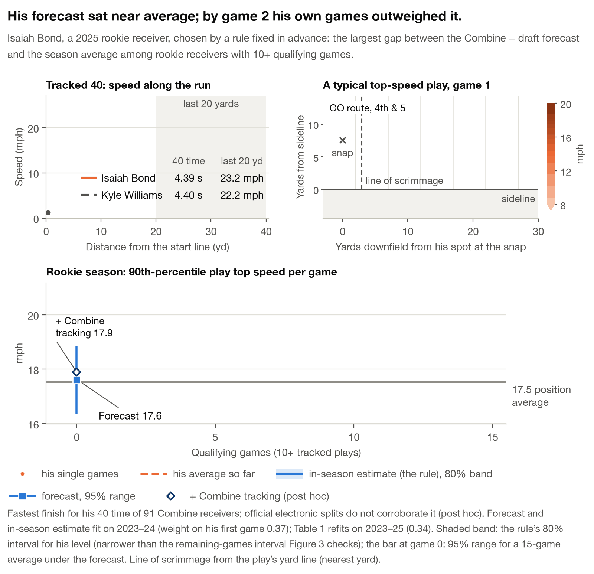
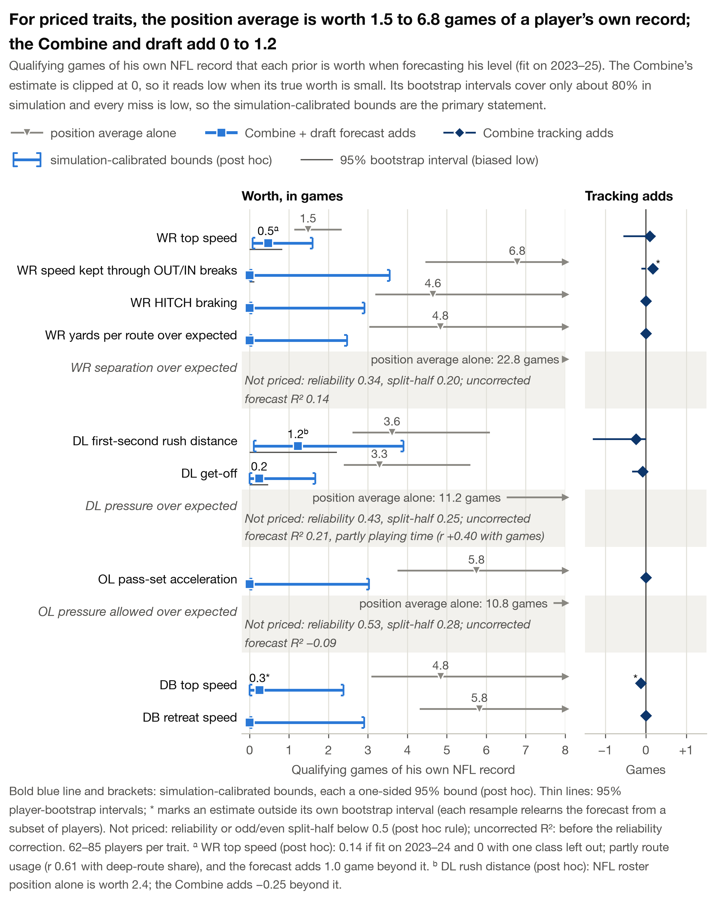
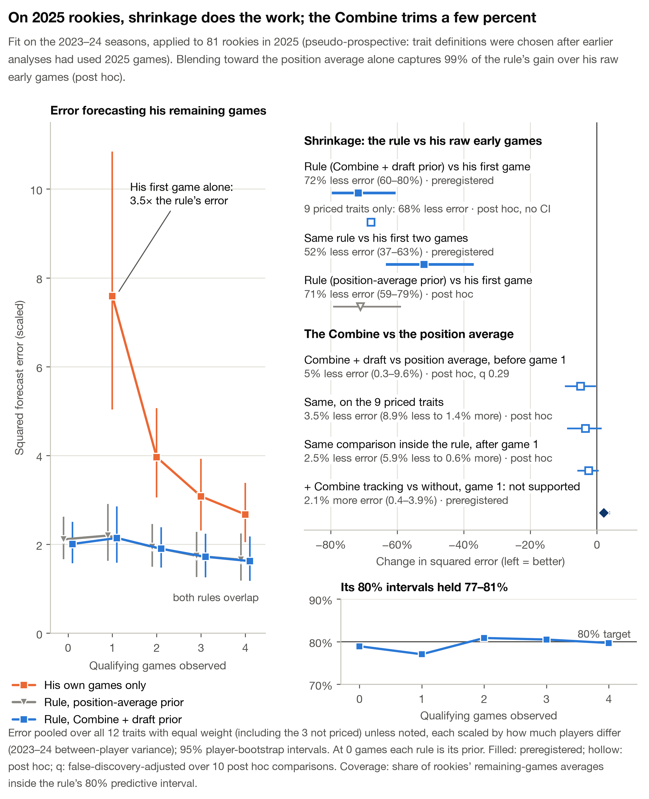
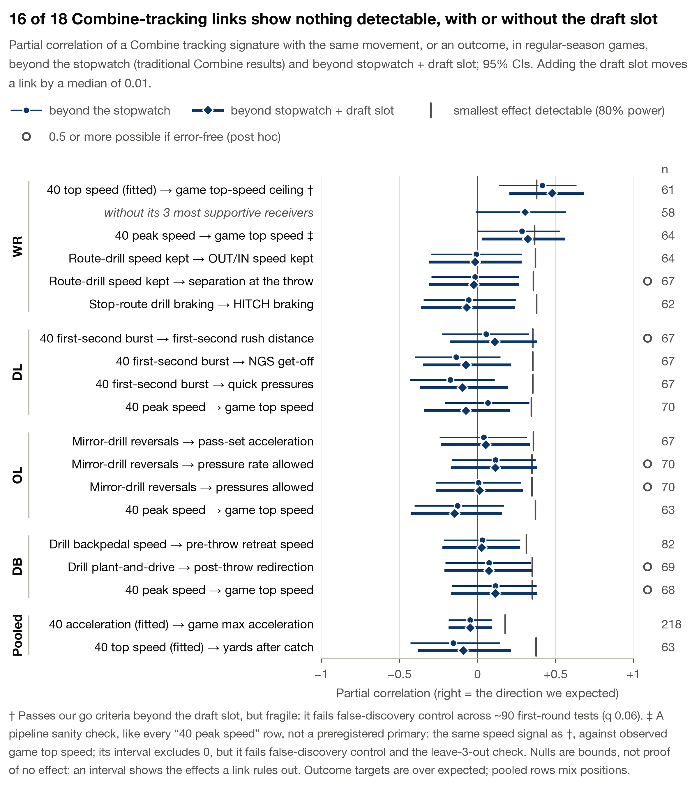
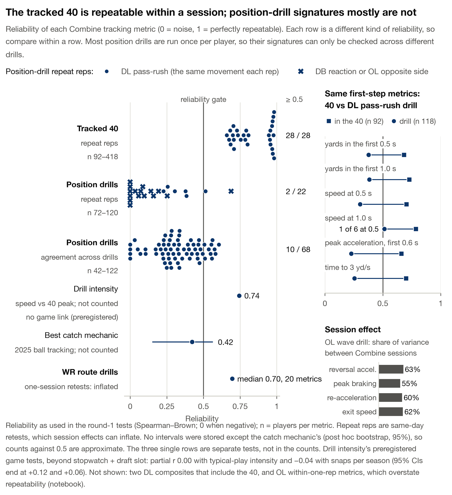

# The Combine Exchange Rate: how many NFL games is a Combine worth?

<!-- WRITEUP v2.2 (Combine Game Equivalents framing, Gate 2b), 2026-10-15. v2.1 revised v2 after two mock judges (Football/Writeup; Data Science/Data Viz); v2.2 applies the final checker's findings (word budget, hook accuracy, selection pools, drill-reliability framing, captions). writeup/outline.md sections 10-11 list every item as applied, rejected or deferred. Every number in the text carries a source comment ("src:") naming the committed results file and its JSON key: experiments/results/E0xx.json, E007_leaderboard.json, experiments/posthoc_writeup_v1/*.json, or experiments/posthoc_writeup_v2/e012_case_priors.json. A few numbers are arithmetic on committed keys (sums, ratios, a Spearman-Brown inversion, a binomial chance); each comment states the formula and writeup/check_numbers.py recomputes it. The checker asserts each number at its quoted rounding, asserts each quoted string is in the text, fails on any number in the text that no check covers, and enforces the budget (rendered words <= 1,900; whitespace tokens <= 1,950 counted both on the pasted markdown and on the rendered text; <= 8 figures + tables). Strip all HTML comments before pasting into Kaggle. Counts exclude comments and image links; captions and table cells count. Test labels: preregistered = in E012_prereg.json (H1-H3) or an earlier prereg; post hoc = chosen after results were seen. "Combine + draft forecast" = information set C2 (stopwatch + measurements + draft slot = protocol B2); "position average" = C0; "Combine tracking" = C3 - C2. "Qualifying game" = a game with at least the trait's minimum plays (E012.json traits[T].min_plays_per_game). Receiver A = nfl_id 59278 (names withheld: outline section 7). mph = yd/s x 3600/1760. Figures: Figure 1-5 + Table 1 = 6 of the 8 allowed; see writeup/figure_plan.md. -->

## 1. One rookie, fifteen games

Receiver A ran a 4.39 forty at the 2025 Combine; tracking clocked his last 20 yards at 23.2 mph, the fastest finish for his 40 time of 91 Combine receivers. A forecast from his Combine results and draft slot, fit on 2023–24, put his game top speed (his 90th-percentile play peak, well below a sprint) at 17.6 mph, beside the 17.5 receiver average. He hit 18.3 in his first qualifying game and averaged 18.9 over 15.
<!-- src: E007_leaderboard.json players[nfl_id=59278].official_forty 4.39, draft_year 2025, flying20_mph 23.15 (average speed over the last 20 yards of his tracked 40s), rank 1 by hidden_speed_mph (finishing speed beyond what the official 40 predicts), meta.n 91; ph_pairs.json hook_fast_rank_hidden_of_91 1 (cross-check). E012.json deliverables.case_studies[nfl_id=59278, trait T1]: prior_C2 8.607 yd/s = 17.6 mph (Combine results + draft slot, fit on the 2023-24 seasons: validation_2.design_label; case-study panels use that fit); prior_C0 8.568 yd/s = 17.5 mph (position average); game_values[0] 8.95 yd/s = 18.3 mph; season_mean 9.239 yd/s = 18.9 mph over n_games 15. Game top speed = per-game q90 of play max speed (E012_prereg.json traits[T1].game_value; E012.json traits.T1.per_game_value "q90"). Qualifying = >= 10 tracked plays (traits.T1.min_plays_per_game 10). Draft status deliberately not mentioned: the forecast includes draft slot, which also reflects medical and off-field factors (Limitations). -->

That was two forecast standard deviations high, the largest gap among the 11 of 15 rookie receivers in our 2025 test with ten or more qualifying games (a rule fixed in advance picked him). This is no Combine failure: in that fit the forecast was worth only 0.14 games, and among 11 receivers a calibrated forecast misses at least one by two standard deviations about 40% of the time. Combine tracking nudged his forecast 0.3 mph toward his season average, yet across all 15 it left error after one game within noise (ratio 0.96, 95% CI 0.80–1.09); official electronic splits do not corroborate tracked finishing speed.
<!-- src: case_studies[59278].z_predictive 2.009 ("two forecast standard deviations"). Pools: experiments/posthoc_writeup_v2/e012_case_priors.json pools.T1.n_test_players_k0 15 (= validation_2.primary.H1.n_by_trait.T1 15 = secondary_per_trait.T1["1"].n 15) and pools.T1.n_with_10plus_games 11 (post hoc export of the stored forecasts). Selection: E012_prereg.json deliverables[2] "the 2 largest and 2 smallest |prior - final| per position among players with >= 10 games" (fixed before the data); case_studies[59278].rule "largest |C2 prior - season mean|", abs_gap 0.632, the largest of the WR case studies, so the largest of the 11 by absolute gap. "Worth only 0.14 games" = case_studies[59278].cge_C2_2023_24_fit 0.135 (= cge_table[T1].cge_C2_2023_24_seasons_fit). Not "flat": post_hoc_review.validation_2.per_trait.T1.c2_prior_spread_tau 0.55 and c2_prior_flat false, so the text does not say the forecast called every receiver average. "About 40%" = 1 - (1 - P(|z| >= 2))^11 = 1 - 0.9545^11 = 0.40 (arithmetic over the same 11 the rule chose among; a calibrated forecast's z is standard normal). Tracking nudge: e012_case_priors.json cases[nfl_id 59278, T1] prior_C3 8.749 - prior_C2 8.607 = tracking_shift_C3_minus_C2 0.142 yd/s = 0.29 mph, toward season_mean 9.239 (2023-24 fit, as the case study); prior_C1 8.683 (stopwatch and measurements only) is not quoted. WR top-speed tracking test over all 15: E012.json validation_2.secondary_per_trait.T1["1"].blend_C3_vs_blend_C2 ratio 0.960, ratio_ci95 [0.798, 1.089], p_one_sided 0.32 (n 15; descriptive secondary, E012_prereg.json validation_2_prospective.secondary); pooled over 12 traits it is H3 (section 3.3). Official splits: E007_leaderboard.json meta.post_hoc_official_splits.corr_tracked_vs_official_10_40_time_beyond_forty -0.11 and its note "not corroborated by the official electronic 10-yd split" (post hoc, E007). -->

What worked was the in-season rule: by his second game his own record outweighed the forecast (Figure 1). Table 1 gives that moment for 12 traits, in the unit clubs think in: games.
<!-- src: case_studies[59278].weight_C2[1] 0.538 > 0.5 (2023-24 fit) and traits.T1.half_weight_game.C2.est 1.95 < 2 (internal fit): after 2 qualifying games his own average carries more than half the weight. 12 traits = Table 1 rows (E012.json traits T1-T12). -->

**Figure 1.** Receiver A (animated): tracked 40, a typical game-1 top-speed play, then his forecasts, rookie games and in-season estimate.

## 2. The Combine Exchange Rate

Clubs judge rookies game by game: is an 18.3 mph debut real, and what is the Combine, now tracked at 10 Hz, worth once games arrive? For 12 game traits at WR, DL, OL and DB, we split per-game values into a stable level and game-to-game noise. A **qualifying game** has enough plays to measure the trait (WR top speed: 10 tracked plays). After λ qualifying games (the noise-to-signal ratio) his own average is half signal, so the position average is worth λ games. A Combine-based forecast adds **Combine Game Equivalents (CGE)**: the extra games of his own tracking that forecast his level as well, out of sample. That price is the **Combine Exchange Rate**. After k qualifying games:

> estimate = prior + w × (his average − prior), with **w = k/(k + λ + CGE)**

For WR top speed (λ 1.5, CGE 0.5), four games give w = 0.67, with standard error σ/√(k + λ + CGE) = 0.33 mph (σ = 0.8 mph, the single-game noise). This is credibility weighting (baseball's "stabilization points"), with λ + CGE the prior's effective sample size; what is new is pricing the Combine, and tracking traits, in that currency.
<!-- src: 18.3 mph = Receiver A's first qualifying game (E012.json deliverables.case_studies[59278].game_values[0] 8.95 yd/s), as in section 1. 12 traits = E012.json traits (T1-T12; positions WR, DL, OL, DB). Qualifying = traits[T].min_plays_per_game (T1 10). lambda = sigma2 / tau2 (E012_prereg.json framework.model: "games of noise per unit of signal"); reliability of a k-game mean = k / (k + lambda), so half signal at k = lambda, and the weight on his average with the position-average prior is k / (k + lambda) (deliverables.weight_curves[T].C0.half_weight_game = lambda). CGE = lambda R2 / (1 - R2) with R2 the cross-validated R2 on the player-level trait divided by its reliability (framework.estimand). Weight k / (k + lambda + CGE): E012.json amendments[0] (A1). Worked example: cge_table[T1].lambda.est 1.480, cge_C2.est 0.471; deliverables.weight_curves.T1.C2.w[4] 0.672 (0.67). Standard error: posterior_var(k) = 1 / (1 / ((1 - R2) tau2) + k / sigma2) (src/bdb27/probes/h_game_equivalents.py) = sigma2 / (k + lambda + CGE); sigma = sqrt(traits.T1.variance.sigma2.est 0.1525) = 0.391 yd/s = 0.80 mph; at k = 4: 0.80 / sqrt(4 + half_weight_game.C2.est 1.951) = 0.327 mph (0.33). Prior art: credibility theory (Buhlmann); sabermetric "stabilization points" (reliability of a k-PA rate = k / (k + lambda)); prior effective sample size (Morita, Thall & Mueller 2008, Biometrics). -->

We price four priors: the position average; plus stopwatch and measurements; plus draft slot (the **Combine + draft forecast**); plus **Combine tracking** (tracked-40 speed profile, matched drill signature). The design was preregistered; one amendment, made before any real-data run, fixed the weight formula. After review we stopped pricing traits with reliability or odd/even split-half below 0.5 (post hoc).
<!-- src: Information sets C0-C3: E012_prereg.json information_sets (C3 = tracked-40 set c40_smax, c40_v_20_40, c40_vmax, c40_tau, c40_a0 plus the trait's matched drill signature). E012_prereg.json (written "before any CGE, variance component or in-season forecast"); E012.json amendments[0].status "Recorded before any CGE, variance component, R2 or forecast on real data". Identification rule: E012.json post_hoc[PH7] (post hoc) and post_hoc_review.per_trait[T].identification_rule "rel >= 0.5 and odd/even split-half >= 0.5 (PLAN 4, criterion 5)". -->

## 3. Results

### 3.1 His own games take over within two to seven games

For the nine reliably measured traits, a rookie's qualifying games outweigh the Combine + draft forecast after 2.0 (WR top speed) to 6.8 games (Table 1): the position average is worth 1.5 to 6.8 games, the Combine and draft 0 to 1.2 more. At 2025 rookies' rates (47–92% of appearances qualified), that is three to 12 appearances.
<!-- src: nine = count of E012.json cge_table[*].identified true (T1, T2, T3, T5, T6, T7, T9, T11, T12). Half-weight game (C2) = traits[T].half_weight_game.C2.est = lambda + CGE: min T1 1.951, max T2 6.784 over the identified traits. lambda (= C0 half-weight): cge_table[T].lambda.est min T1 1.480, max T2 6.784. CGE: cge_table[T].cge_C2.est 0 to T6 1.227. post_hoc_review.validation_2.qualifying_share_2025_rookies[*].share: min T3 0.469, max T11 0.917. Appearances = half-weight / share (arithmetic): T1 1.951 / 0.597 = 3.3 (fewest), T2 6.784 / 0.549 = 12.4 (most) over the identified traits; per trait in Table 1. -->

Outcome traits (separation, pressure and pressure allowed over expected) are slowest: half signal only after 11–23 qualifying games, about 14–39 appearances; a rookie pass rusher's pressure rate needs about 22.
<!-- src: cge_table[T10, T8, T4].lambda.est 10.84, 11.22, 22.80 (not-identified traits; lambda is estimated, the Combine's CGE is not). Appearances = lambda / qualifying_share_2025_rookies[T].share: T10 10.84 / 0.796 = 13.6, T8 11.22 / 0.509 = 22.1, T4 22.80 / 0.587 = 38.9 (arithmetic). -->

**Table 1.** Trust table (fit on 2023–25), prior = Combine + draft forecast. With only the position average, use k/(k + λ).

|Trait (qualifying game)|Prior worth, games (λ+CGE)|Outweighed after (95% CI)|≈ Appearances|Weight after 1/4/8|
|-|-|-|-|-|
|WR top speed (≥10 plays)|1.5+0.5|2.0 (1.2–2.7)|3|0.34/0.67/0.80|
|DL get-off (≥5 rushes)|3.3+0.2|3.5 (2.4–5.8)|5|0.22/0.53/0.69|
|WR HITCH braking (≥2 breaks)|4.6+0|4.6 (3.2–9.0)|10|0.18/0.46/0.63|
|DL first-second rush distance (≥5 rushes)|3.6+1.2|4.8 (2.7–6.9)|6|0.17/0.45/0.62|
|WR yards per route over expected (≥10 routes)|4.8+0|4.8 (3.1–13.2)|8|0.17/0.45/0.62|
|DB top speed (≥10 plays)|4.8+0.3|5.1 (3.1–9.7)|6|0.16/0.44/0.61|
|WR speed kept through OUT/IN breaks (≥2 breaks)|6.8+0|6.8 (4.5–14.0)|12|0.13/0.37/0.54|
|OL pass-set acceleration (≥10 sets)†|5.8+0|5.8 (3.7–12.3)|7|—|
|DB retreat speed (≥3 plays)†|5.8+0|5.8 (4.3–9.0)|6|—|
|OL pressure allowed over expected (≥15 snaps)‡|10.8+—|10.8 (7.7–21.1)|14|0.08/0.27/0.42|
|DL pressure over expected (≥10 rushes)‡|11.2+—|11.2 (6.5–44.1)|22|0.08/0.26/0.42|
|WR separation over expected (≥3 routes)‡|22.8+—|22.8 (13.2–97.8)|39|0.04/0.15/0.26|

0: no out-of-sample gain (clipped). †Levels shift between seasons (up to 2.2 between-player SD): no weights. ‡Not priced (too noisy per game); weights use the position average.
<!-- src (internal fit on the 2023-25 classes: E012.json deliverables.weight_curves[T].fit). Prior worth = cge_table[T].lambda.est + cge_table[T].cge_C2.est (1 dp each): T1 1.480 + 0.471, T7 3.291 + 0.245, T3 4.647 + 0, T6 3.610 + 1.227, T5 4.837 + 0, T12 4.843 + 0.254, T2 6.784 + 0, T9 5.751 + 0, T11 5.826 + 0; not identified (cge_table[T4, T8, T10].identified false): lambda only, T10 10.84, T8 11.22, T4 22.80. Outweigh-after = traits[T].half_weight_game.C2.est (= lambda + CGE = deliverables.weight_curves[T].C2.half_weight_game) with ci95_prereg_bootstrap (B1; under-covers, section 3.2); for the not-identified rows the position-average half-weight = lambda with cge_table[T].lambda lo / hi. Appearances = outweigh-after / post_hoc_review.validation_2.qualifying_share_2025_rookies[T].share, rounded (arithmetic). Weights = deliverables.weight_curves[T].C2.w[k] at k = 1, 4, 8; not-identified rows weight_curves[T].C0.w[k] (position-average prior). Minimum plays = traits[T].min_plays_per_game (T1/T12 10, T7/T6 5, T3/T2 2, T5 10, T9 10, T11 3, T10 15, T8 10, T4 3; units per E012_prereg.json traits[T].game_value). Zeros: cge_table[T].cge_C2.est = 0 because true-score R2 is clipped at 0 (E012_prereg.json framework.estimand). Footnote: post_hoc_review.per_trait[T9, T11].stationarity_and_game_unit.season_change_within_player[*].mean_tau, max |value| 2.194 (T9, 2023 class 2023->2024); T11 up to 1.44; T9 also within_season_trend_tau_per_16_weeks 1.12. -->

### 3.2 The Combine is worth a fraction of a game to about one

The Combine + draft forecast's worth runs from 0 (five traits) to 1.2 games (Figure 2). The preregistered bootstrap intervals all include 0 but are biased low, covering about 80% in simulation. Simulation-calibrated bounds (post hoc) put WR top speed at 0.08–1.6 games, DL rush distance at 0.10–3.9, and the rest below 1.7–3.6.
<!-- src: E012.json cge_table[*].cge_C2.est: T6 1.227, T1 0.471, T7 0.245, T12 0.254; zero for T2, T3, T5, T9, T11. All include 0: cge_table[*].cge_C2.lo = 0 for all 12 (interval_note: "Every B1 CGE interval includes 0"). Biased low: bootstrap_bias_diagnostic (B1 R2 draws centre below the point estimate; traits.T1.cge.C2.ci95_prereg_bootstrap.share_draws_below_est 0.909). Coverage: post_hoc_review.simulation.interval_coverage.T1.b1.coverage 0.775, T6.b1.coverage 0.825 (nominal 0.95); every miss is low: share_upper_below_truth 0.225 (T1), 0.175 (T6) = 1 - coverage. Calibrated one-sided 95% bounds (post hoc PH6): cge_table[T1].cge_C2_calibrated_lower95 0.079, _upper95 1.597; T6 0.105, 3.900; the other seven identified traits lower95 0 and upper95 from T7 1.669 to T2 3.553. -->

The estimate is conservative (the Combine as learned from 62–85 players, negative fits clipped to 0): against the position average under the same cross-validation, five traits reach 0.4–1.7 games (post hoc).
<!-- src: E012.json post_hoc[PH6].what and post_hoc_review.simulation.calibrated_bounds.estimand ("the Combine as learned by the ridge from 80% of the trait's players"); n_players: cge_table[*].n_players min 62 (T3), max 85 (T6); clipping: framework.estimand / interval_note ("For a zero point estimate the B1 interval is [0, 0]"); class averages: post_hoc[PH8].what ("the Combine side otherwise pays the out-of-fold cost of estimating class means"). cge_table[T].cge_C2_vs_C0_same_cv (post hoc PH8): T7 0.430, T2 0.495, T1 0.649, T12 0.670, T6 1.746 are the five >= 0.4; T3 0, T5 0.015, T9 0, T11 0.020. -->

The two largest values are soft (post hoc). DL rush distance (1.2) is body type and role: roster position alone is worth 2.4 games, the Combine −0.25 beyond it. WR top speed (0.5) falls to 0.14 in the 2023–24 fit and to 0 without one draft class; it partly reflects route usage (r 0.61 with deep-route share), though the forecast adds 1.0 game beyond deep share.
<!-- src: cge_table[T6].cge_role_reference 2.362, cge_C2_beyond_role -0.247 (role = NFL roster position; post hoc PH8). cge_table[T1].cge_C2_2023_24_seasons_fit 0.135, cge_C2_leave_one_class_out_range [0.0, 0.421]. post_hoc_review.per_trait.T1.references.role: reference "deep-route share (GO/POST/CORNER/WHEEL) over all REG routes: in-season usage", r_trait_deep_share 0.612, combine_beyond_ref 1.045 (cge_table[T1].cge_C2_beyond_role). -->

The three outcome traits are not priced (reliability 0.34–0.53, split-half 0.20–0.28). Yet before the reliability correction the forecast fit DL pressure (cross-validated R² 0.21) about as well as WR top speed (0.22), partly via playing time (r +0.40 with qualifying games).
<!-- src: cge_table[T4, T8, T10]: identified false; rel_player_mean 0.341, 0.429, 0.527; split_half 0.200, 0.250, 0.284. Identification rule post hoc: post_hoc[PH7]. cge_table[T8].r2_cv.C2 0.209, cge_table[T1].r2_cv.C2 0.215 (cross-validated R2 before the reliability correction). cge_table[T8].exposure_r_trait_log_games 0.399 (notes: "the player trait correlates +0.40 with log qualifying games"). 11-23 = cge_table[T10, T8, T4].lambda.est (section 3.1). -->

**Figure 2.** Worth in games per trait: position average; Combine + draft forecast, simulation-calibrated bounds bold, bootstrap thin; tracking's increment (right).

### 3.3 Combine tracking adds nothing measurable

Combine tracking changes the forecast's worth by −0.24 to +0.18 games across the nine traits, every interval including 0. On 2025 rookies it made the estimate after one game 2.1% worse (95% CI 0.4% to 3.9%; preregistered, 12 traits pooled). That describes our model at this sample size; Section 5's signal is in-sample, on another target.
<!-- src: E012.json cge_table[identified].delta_cge_tracking.est (C3 - C2): min T6 -0.242, max T2 0.176; every delta_cge_tracking lo <= 0 <= hi (B1). validation_2.primary.H3: blend with C3 prior vs blend with C2 prior at k = 1 (claim "blend with C3 prior beats blend with C2 prior at k = 1"), ratio 1.0206, ratio_ci95 [1.0040, 1.0391], p_one_sided 0.99 (expected C3 < C2; not supported); n_by_trait has all 12 traits. Section 5's target is extrapolated top-speed capacity S0 (E008 transfer_map[E006-P1]); E012 T1 is observed per-game top speed. -->

### 3.4 2025 rookies: shrinkage works, and the rule is calibrated

To test the rule, we fit on 2023–24 and forecast each 2025 rookie's remaining games from his first k (81 rookies, 222 player-traits). The test is pseudo-prospective: trait definitions were chosen after earlier analyses had used 2025 games. After one game the rule cut squared error 72% against his game alone (95% CI 60–80%; 68% on the nine priced traits), after two 52% (both preregistered). Its 80% intervals held 77–81% of rookies' remaining-games averages (after 0–4 games).
<!-- src: E012.json validation_2.design_label ("pseudo-prospective: fit on the 2023-24 seasons only and applied to the 2025 rookies' 2025 season; the trait definitions were fixed after earlier experiments (E001-E011) had used 2025 games"). validation_2.primary.H1: n_players 81, n_player_traits 222, ratio 0.2823 (1 - ratio = 72%), ratio_ci95 [0.2032, 0.3952] (1 - ratio: 60% to 80%), p_one_sided 1e-5, pass true. Identified traits only (post hoc arithmetic with H1's own pooling, an equal-weight mean over traits): mean over the nine identified T of validation_2.secondary_per_trait[T]["1"].se_blend_C2 = 1.725, of .se_games = 5.375, ratio 0.321, cut 68% (the same pooling over all 12 traits reproduces H1's pooled_a 2.143 and pooled_b 7.590 exactly). H2: ratio 0.4798 (52%), pass true. Calibration: validation_2.calibration_80pct.C2[k].pooled_coverage for k = 0..4: 0.789, 0.770, 0.809, 0.805, 0.797 (interval for the mean of his remaining games: posterior variance + sigma2 / m; E012_prereg.json validation_2_prospective.secondary). -->

The credit belongs to shrinkage (Figure 3): blending toward the position average alone captures 99% of that gain. Before game 1 the Combine + draft forecast beats the position average by 5% (95% CI 0.3% to 9.6%), mostly via WR top speed and the unpriced separation trait; on priced traits by 3.5%; after one game by 2.5%. All are post hoc; none survives multiplicity control.
<!-- src: E012.json post_hoc_review.validation_2.shrinkage_share_of_blend_gain["1"] 0.990. validation_2.post_hoc_combine_prior_vs_position_mean.k0.comb_C2_vs_C0: ratio 0.9507 (5% lower), ratio_ci95 [0.9037, 0.9970] (9.6% to 0.3% lower), p_one_sided 0.029. Drivers: post_hoc_review.validation_2.ph3_drivers.k0: the two most negative contribution_to_pooled are T1 (-0.054) and T4 (-0.040; not identified). ph3_drivers.k0_identified_traits_only: ratio 0.9652 (3.5%), ratio_ci95 [0.911, 1.014], p_one_sided 0.102. k1.blend_C2_vs_C0: ratio 0.9754 (2.5%), ratio_ci95 [0.941, 1.006], p_one_sided 0.077. Multiplicity: post_hoc_review.validation_2.ph3_bh_q_over_10, min 0.29 over the 10 comparisons. All post hoc (PH3/PH10). -->

**Figure 3.** 2025 rookies: error by games observed (left); shrinkage's and the Combine's shares (right); 80% interval coverage (bottom right).

## 4. Why the Combine is worth so little

Of 18 links from a Combine tracking signature to the same movement or an outcome in regular-season games, 16 show nothing detectable beyond the stopwatch and draft slot, and the same 16 beyond the stopwatch alone (Figure 4). The draft slot moves partial correlations by a median of 0.01 (at most 0.14; intervals allow 0.37). Unreliable measures do not explain these nulls: 13 of the 16 pass the reliability gate (Combine and game measures both ≥ 0.5). Power and imperfect game targets limit the tests: each null excludes partial correlations above +0.09 to +0.38 (detectable effect 0.31–0.38 at 60–80 players), and for error-free measures effects of 0.5 or more remain possible for six links.
<!-- src: E008.json summary.transfer.n_links 18, n_nulls 16 (beyond B2); E009.json summary.b1_n_nulls 16 with the same two non-null links (summary.b1_passes_c1 = E008 summary.transfer.passes_c1 = E006-P1, E001-WR), so the same 16. E009.json summary.draft_delta_abs_median 0.013, draft_delta_signed_range [-0.079, 0.139], draft_delta_largest_upper_limit.jackknife [E001-DL, 0.367]. Reliability gate: E008.json summary.transfer.nulls_passing_c5 13 (criterion 5: transfer_map[*].c5_reliability_ge_05, true when the Combine feature's rel_x and the game target's rel_y are both >= 0.5; the 3 nulls that fail are E002-P2 and E004-P3 on the game target, E002-P3 on the feature). E008.json summary.transfer.ceiling_per_link_95 [0.095, 0.384]; corrected_beyond_b2_ge_05 (6 links; post hoc). Single-position links: E008.json transfer_map[*].n 61-82, mde80_one_sided 0.313-0.378. E008 is a re-estimate of 14 preregistered primaries + the E001 sanity link; E009 is preregistered but not blind (E009_prereg.json). -->

**Figure 4.** Transfer map: partial correlations beyond the stopwatch, and beyond stopwatch plus draft slot (95% CIs).

## 5. What tracking does show

**Stability is a separate question from transfer.** All 28 tracked-40 metrics are stable traits (reliability ≥ 0.5; top speed 0.95–0.98). Of 22 position-drill metrics with repeat reps, 2 are; of 68 composites across drills that target one skill, 10 are (Figure 5); and 55–63% of OL wave-drill variance lies between Combine sessions. Drill intensity (how close to his 40 peak he runs drills) is stable (0.74) yet predicts neither play speed nor snaps (partial r 0.00 and −0.04; preregistered).
<!-- src: E008.json summary.drill_profile.by_group_kind["40-yd dash | repeat attempts"] n 28, n_ge_05 28; summary.drill_profile.forty.top_speed.rel [0.945, 0.982]. drill_profile rows of kind "repeat attempts" outside the 40: 22, of which 2 >= 0.5. by_group_kind["position drill | cross-drill"] n 68, n_ge_05 10. drill_profile[metric in wave rev_accel / peak_decel / peak_reaccel / exit_speed].share_session 0.548-0.626. E010.json combine.stop_rule.reliability 0.744; game.primaries.P1 partial_r -0.003, partial_r_ci95 [-0.126, 0.120]; P2 partial_r -0.042, partial_r_ci95 [-0.141, 0.058] (E010_prereg.json). Framing: reliability is reported as its own finding, not as the reason for the section 4 nulls (13 of 16 nulls pass the gate). -->

One signal remains suggestive, the kind Receiver A showed: WR top speed fitted from the tracked 40 predicts game top-speed capacity (extrapolated from in-game accelerations) beyond the stopwatch and draft slot (partial r +0.48, 95% CI +0.20 to +0.68). It is fragile: without its three most supportive receivers it falls to +0.31 (−0.01 to +0.57), and it fails false-discovery control across about 90 first-round tests (q 0.06).
<!-- src: E008.json transfer_map[E006-P1]: n 61, partial_r 0.478, ci [0.204, 0.683] (preregistered after the E001 sanity link was seen; same receivers); drop3_partial_r 0.305, drop3_ci [-0.011, 0.566]; summary.multiplicity.E006-P1.bh_q_all_round1_tests 0.063, m_round1_tests 90. E009.json transfer_map[E006-P1].b1_partial_r 0.415 (beyond the stopwatch alone; figure-only since v2.2, Figure 4). Game top-speed capacity = S0, where his top in-game accelerations extrapolate to zero (src/bdb27/speed.py docstring). -->

**Figure 5.** Reliability by measurement type (left); first-step metrics, 40 vs DL pass-rush drill, and OL session effects (right).

## 6. What to do with it

**Clubs, week to week**
1. **Use the trust table with your best prior.** With the position average, WR top speed's weights become 0.40/0.73/0.84 after 1/4/8 games. For DL rush distance, roster role (DE, DT, NT, OLB) beats the Combine: worth 2.4 games, outweighed after 6.0 (post hoc; roles may postdate the draft).
2. **Shrink first.** A rookie's raw first game had 3.5 times the forecast error of the shrunk estimate.
3. **Don't weight Combine tracking.** It is worth about zero games; the stopwatch and draft slot, point estimates 0 to 1.2, more than about 4 ruled out.
4. **Be patient with outcome traits.** The prior carries them most of a season (Table 1).
<!-- src: item 1: E012.json deliverables.weight_curves.T1.C0.w[1, 4, 8] 0.403, 0.730, 0.844 (= k / (k + lambda), lambda 1.480). post_hoc_review.per_trait.T6.references.role: reference "NFL roster position (players.csv nfl_position: DE/DT/NT/OLB); may be the latest roster designation rather than the one known on draft day", cge_ref 2.362, cge_ref_plus_C2 2.115 < cge_ref (the Combine adds nothing beyond role); half-weight with the role prior = cge_table[T6].lambda.est 3.610 + cge_role_reference 2.362 = 5.97 (arithmetic, the A1 formula with the role prior; post hoc PH8). Item 2: validation_2.primary.H1 pooled_b 7.590 / pooled_a 2.143 = 3.54 (games-only vs the C2 blend after one game; the C0 blend is nearly identical: post_hoc_review.validation_2.blend_C0_vs_games.k1 ratio 0.289). Item 3: delta_cge_tracking (section 3.3); cge_table[identified].cge_C2.est 0 to 1.227; cge_C2_calibrated_upper95 max 3.900 (T6). Item 4: cge_table[T10, T8, T4].lambda.est 10.84, 11.22, 22.80 (C0 half-weight game = lambda). -->

**The league's Combine operations**
1. **Identical repeat reps, enough of them.** First-step metrics are stable traits in the 40 (reliability 0.66–0.79) but mostly not in the DL pass-rush drill (0.23–0.51). Most existing repeats are mirror-side or reaction reps; at single-rep reliabilities of 0.15–0.39, two to six identical reps reach 0.5.
2. **Fixed tempo and frozen drill definitions.** Session effects dominate the OL wave drill; the 2025 comeback drill was a different movement.
3. **Ball tracking every year, with height.** The 2025 ball data (no height) time 87% of reached balls within one frame, but no catch mechanic is yet a stable trait (best 0.42); that needs about 6–46 catching drills per player.
<!-- src: item 1: E008.json summary.drill_profile.forty.dl_starts.rel [0.659, 0.785] (first-step metrics d05/d10/s05/s10/amax06/t3 from the 40's start); drill_profile rows scope "pass-rush drill attempts" (same six metrics): rel_round1_def 0.227-0.514 (reliability of each player's mean over his reps; only s10, 0.514, reaches 0.5, hence "mostly not"). 16 of the 22 repeat-attempt rows outside the 40 have scope "45-degree reaction U-turn, 2 attempts" (12) or "pass-rush-drop attempts (opposite sides)" (4). Single-rep reliability = icc_unit of the DL pass-rush rows, 0.147-0.390; reps needed for 0.5 by Spearman-Brown = (1 - icc) / icc: 5.8 at 0.147, 1.6 at 0.390, so two to six (arithmetic). Item 2: wave share_session 0.548-0.626 (section 4); E008.json links[E002-P3].caveats "2025 COMEBACK is a different movement". Item 3: E011.json data.draft_years [2025] (data.players 54, data.drill_names 18, x/y only: log E011; counts not quoted since v2.2); detection.contact_time_check.share_within_0.1s 0.869 (n 488 reached; post hoc after review); reliability[*].cross_drill.reliability max catch_offset 0.423; reliability.catch_offset.drills_needed_range_from_icc_ci.for_0.5 [6.1, 46.2] (point 11.1; distinct drills). -->

## 7. Limitations

- **Small samples:** 62–85 players per trait, three classes, one season for 2025 rookies.
- **Estimand:** the Combine as learned from these players; a perfectly learned signal could be worth up to 15 games in simulation.
- **Inference:** intervals under-cover; the 2025 test is pseudo-prospective; several comparisons are post hoc.
- **Game units:** qualifying games count equally, though low-play games are 2.0–3.5 times noisier (9 of 12 traits); no opponent adjustment; position averages pool roles (edge with interior, corner with safety).
- **Draft slot** also reflects medical and off-field factors.
<!-- src: E012.json cge_table[*].n_players min 62 (T3), max 85 (T6); draft classes 2023-25 (traits[T].by_class). cge_table[*].cge_C2_population_signal_upper95 max 14.93 (T2; post hoc PH6). Under-coverage: section 3.2. Post hoc: post_hoc[PH6-PH8, PH10, PH11] (sections 3.2-3.4). Noise: post_hoc_review.per_trait[T].stationarity_and_game_unit.noise_ratio_lowest_vs_highest_plays_quartile (within-player variance, lowest vs highest plays-per-game quartile; post hoc PH11): >= 2 for 9 of 12 traits, range 2.01 (T7) to 3.45 (T11); T8 1.37, T9 1.05, T10 1.60. Equal weights and no opponent adjustment: E012.json review_response R2.5. Roles pooled: per_trait[T6/T12].references.role reference lists DE/DT/NT/OLB and CB/FS/ILB/MLB/SS within one position average. -->

**Code.** The public notebook regenerates every number, table and figure from raw data, with trait definitions and position averages: [[TBD-NOTEBOOK-LINK]].
